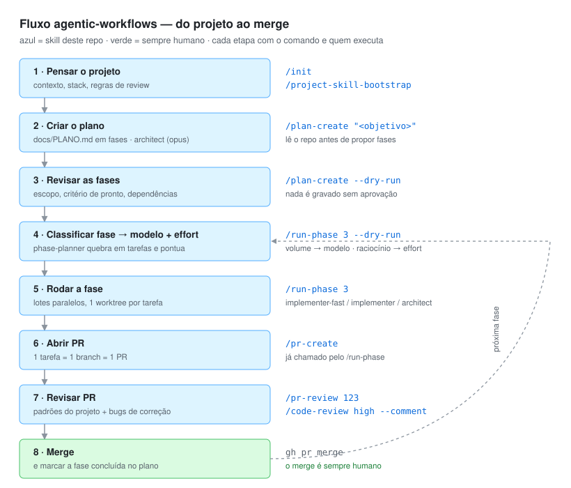

# agentic-workflows

Biblioteca pessoal de **skills, subagents, workflows e boas práticas** para Claude Code —
reaproveitável em projetos pessoais e no trabalho.

## Estrutura

```
skills/                  # skills globais (instaláveis em ~/.claude/skills)
  project-start/         # começa um app do zero com o fluxo; sem argumento diz "onde estou"
  plan-create/           # cria docs/PLANO.md em fases, no formato que run-phase consome
  run-phase/             # executa fase(s) de um plano, escolhendo modelo e effort por tarefa
  pr-create/             # abre PR padronizado (branch, conventional commits, descrição)
  pr-review/             # revisa PR contra padrões do projeto
  frontend-component/    # cria componente React com teste, a11y e padrões
  project-skill-bootstrap/  # gera skills específicas de um projeto (ex.: pr-review do projeto X)
agents/                  # subagents (instaláveis em ~/.claude/agents)
  phase-planner.md       # opus*  — quebra uma fase em tarefas + atribui modelo/effort
  implementer-fast.md    # haiku  — tarefas mecânicas
  implementer.md         # sonnet — feature padrão
  architect.md           # opus*  — design, dados, decisões difíceis
  pr-reviewer.md         # revisão read-only
templates/project/       # esqueleto .claude/ + docs/WORKFLOW.md (estado e ciclo) para projeto novo
templates/review-rules/  # regras de PR por stack: nestjs.md, spring.md, react.md
docs/fluxo.svg           # diagrama do fluxo (usado no README)
docs/best-practices/     # guias: skills, subagents, worktrees, seleção de modelo, workflows
notes/                   # avaliações de projetos (ex.: notebook-monitor)
scripts/install.sh       # symlink de skills/agents para ~/.claude
```

## Instalação

```bash
./scripts/install.sh            # global: ~/.claude/skills e ~/.claude/agents
./scripts/install.sh ../meu-app # num projeto: ../meu-app/.claude/
```

Symlinks: editou aqui, vale em todo lugar.

## Review por projeto

A skill `pr-review` é uma só; o que muda é `<projeto>/.claude/review-rules.md`.
Comece copiando o modelo da stack (`templates/review-rules/`) ou rode
`/project-skill-bootstrap` no projeto. O review é estático: lê regras + diff,
nunca sobe app, Docker ou banco.

## Começando do zero

1. `./scripts/install.sh` (uma vez).
2. Na pasta do app novo: `/project-start "<ideia em uma frase>"` — entrevista, esqueleto,
   `CLAUDE.md`, `review-rules.md` e `docs/WORKFLOW.md`.
3. Sessão nova: `/plan-create "<objetivo>"`.
4. Daí em diante, uma etapa por sessão seguindo o ciclo de `docs/WORKFLOW.md`.
   Perdido? `/project-start` sem argumento lê o estado e diz o próximo comando.

## Fluxo principal

Do projeto ao merge, com o comando de cada etapa:



| # | Etapa | Comando | Quem executa |
|---|-------|---------|--------------|
| 1 | Pensar o projeto: contexto, stack, regras de review | `/project-start` (do zero) ou `/project-skill-bootstrap` (código existente) | skill |
| 2 | Criar `docs/PLANO.md` a partir de um objetivo | `/plan-create "<objetivo>"` | `architect` (opus) |
| 3 | Revisar as fases antes de gravar o plano | `/plan-create --dry-run` | `architect` (opus) |
| 4 | Classificar a fase em tarefas e escolher modelo + effort | `/run-phase <fase> --dry-run` | `phase-planner` (opus) |
| 5 | Executar a fase em lotes paralelos, 1 worktree por tarefa | `/run-phase <fase>` | `implementer-fast` / `implementer` / `architect` |
| 6 | Abrir um PR por tarefa (1 tarefa = 1 branch = 1 PR) | `/pr-create` | skill (chamada pelo `run-phase`) |
| 7 | Revisar contra `.claude/review-rules.md` e caçar bugs | `/pr-review <n>`, `/code-review high --comment` | `pr-reviewer` + review nativo |
| 8 | Merge e marcar a fase como concluída no plano | `gh pr merge` | sempre humano |

Pontuação no passo 4, em dois eixos: **volume** escolhe o modelo (0–2 haiku, 3–5 sonnet,
6+ opus) e **raciocínio** escolhe o effort (`medium` → `xhigh`).

\* `architect` e `phase-planner` usam `model: inherit`: pedem opus quando a conta tem e
caem em `sonnet` + `effort: xhigh` quando não — sempre avisando qual tarefa foi rebaixada.

Leia [docs/best-practices/model-selection.md](docs/best-practices/model-selection.md) primeiro.

### Lacunas conhecidas

- **`--dry-run` do `run-phase` não persiste a decisão.** A tabela de modelos existe só no
  chat; uma flag
  `--annotate` deveria gravar modelo e lotes dentro da fase no `PLANO.md`.
- **Passo 7 tem dois reviews sem critério.** `/pr-review` (padrões do projeto) e
  `/code-review` (bugs de correção) são complementares, mas a ordem não está documentada
  dentro da skill.
- **O plano é marcado cedo.** O `run-phase` marca tarefas concluídas na abertura do PR,
  não no merge — falta um gatilho pós-merge.
