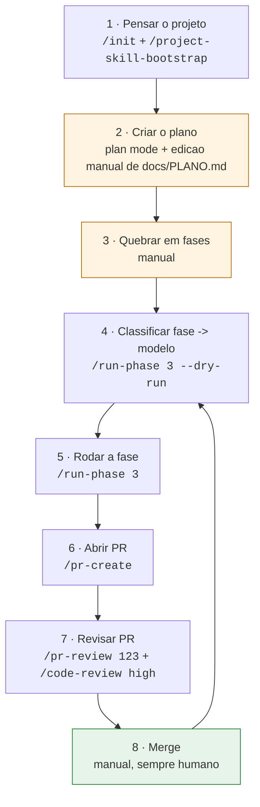

# agentic-workflows

Biblioteca pessoal de **skills, subagents, workflows e boas práticas** para Claude Code —
reaproveitável em projetos pessoais e no trabalho.

## Estrutura

```
skills/                  # skills globais (instaláveis em ~/.claude/skills)
  run-phase/             # executa fase(s) de um plano, escolhendo modelo por tarefa
  pr-create/             # abre PR padronizado (branch, conventional commits, descrição)
  pr-review/             # revisa PR contra padrões do projeto
  frontend-component/    # cria componente React com teste, a11y e padrões
  project-skill-bootstrap/  # gera skills específicas de um projeto (ex.: pr-review do projeto X)
agents/                  # subagents (instaláveis em ~/.claude/agents)
  phase-planner.md       # quebra uma fase em tarefas + atribui modelo
  implementer-fast.md    # haiku  — tarefas mecânicas
  implementer.md         # sonnet — feature padrão
  architect.md           # opus   — design, dados, decisões difíceis
  pr-reviewer.md         # revisão read-only
templates/project/       # esqueleto .claude/ para colar num projeto novo
templates/review-rules/  # regras de PR por stack: nestjs.md, spring.md, react.md
docs/best-practices/     # guias: skills, subagents, worktrees, seleção de modelo, workflows
notes/                   # avaliações de projetos (ex.: notebook-monitor)
scripts/install.sh       # symlink de skills/agents para ~/.claude
```

## Instalação

```bash
./scripts/install.sh            # global: ~/.claude/skills e ~/.claude/agents
./scripts/install.sh ../meu-app # num projeto: ../meu-app/.claude/
```

Symlinks: editou aqui, vale em todo lugar.

## Review por projeto

A skill `pr-review` é uma só; o que muda é `<projeto>/.claude/review-rules.md`.
Comece copiando o modelo da stack (`templates/review-rules/`) ou rode
`/project-skill-bootstrap` no projeto. O review é estático: lê regras + diff,
nunca sobe app, Docker ou banco.

## Fluxo principal

Do projeto ao merge, com o comando de cada etapa:



| # | Etapa | Comando | Quem executa |
|---|-------|---------|--------------|
| 1 | Pensar o projeto: contexto, stack, regras de review | `/init`, `/project-skill-bootstrap` | skill |
| 2 | Criar `docs/PLANO.md` | plan mode + edicao manual | manual |
| 3 | Quebrar o plano em fases com critério de pronto | manual | manual |
| 4 | Classificar a fase em tarefas e escolher o modelo | `/run-phase <fase> --dry-run` | `phase-planner` (opus) |
| 5 | Executar a fase em lotes paralelos, 1 worktree por tarefa | `/run-phase <fase>` | `implementer-fast` / `implementer` / `architect` |
| 6 | Abrir um PR por tarefa (1 tarefa = 1 branch = 1 PR) | `/pr-create` | skill (chamada pelo `run-phase`) |
| 7 | Revisar contra `.claude/review-rules.md` e caçar bugs | `/pr-review <n>`, `/code-review high --comment` | `pr-reviewer` + review nativo |
| 8 | Merge e marcar a fase como concluída no plano | `gh pr merge` | sempre humano |

Pontuação de modelo no passo 4: 0–2 haiku, 3–5 sonnet, 6+ opus.
Leia [docs/best-practices/model-selection.md](docs/best-practices/model-selection.md) primeiro.

### Lacunas conhecidas

- **Passos 2 e 3 nao tem skill.** O `/run-phase` assume um `docs/PLANO.md` ja dividido
  em fases, mas nada no repo produz esse arquivo. Falta uma `/plan-create` que leia o
  repo e escreva o plano no formato que o `phase-planner` consome.
- **`--dry-run` nao persiste a decisao.** A tabela de modelos existe so no chat; uma flag
  `--annotate` deveria gravar modelo e lotes dentro da fase no `PLANO.md`.
- **Passo 7 tem dois reviews sem critério.** `/pr-review` (padroes do projeto) e
  `/code-review` (bugs de correcao) sao complementares, mas a ordem nao esta documentada
  dentro da skill.
- **O plano e marcado cedo.** O `run-phase` marca tarefas concluidas na abertura do PR,
  nao no merge — falta um gatilho pos-merge.
