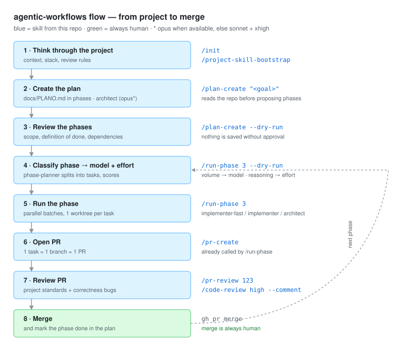

# agentic-workflows

Personal library of **skills, subagents, workflows and best practices** for Claude Code,
reusable in personal and work projects.

The idea: you think through the project and approve the decisions; the agents break the phases into
tasks, choose the model for each one, implement in parallel and open the PRs. The merge
is always yours.

## Installation

```bash
./scripts/install.sh            # global: ~/.claude/skills and ~/.claude/agents
./scripts/install.sh ../my-app  # in a project: ../my-app/.claude/
```

Symlinks: edit here, it applies everywhere.

- **Prefer the global install.** A per-project install creates absolute symlinks for this machine;
  if the app's `.claude/` is committed, they break for other people and in CI.
- **A new skill or agent requires running the script again.** The link is only created when the script
  runs; editing something that already exists does not require it.

## Quick start

**New project**, in the app folder:

```text
/project-start "<idea in one sentence>"   # interview, stack, skeleton, CLAUDE.md, review-rules.md, docs/WORKFLOW.md
/plan-create "<goal>" --dry-run           # see the phases without writing
/plan-create "<goal>"                     # writes docs/PLAN.md
/run-phase 1 --dry-run                    # see tasks, model and effort of each one
/run-phase 1                              # runs: 1 worktree and 1 PR per task
```

**Project that already has code:** replace the first step with `/project-skill-bootstrap`
(generates `CLAUDE.md` and `review-rules.md` from the repository).

**From a Jira task:** replace `/plan-create` with `/jira-plan`. It reads the
task and its subtasks and writes the same `docs/PLAN.md`, with the Jira key on each phase:

```text
/jira-plan PROJ-123 --dry-run   # see the subtask → phase mapping without writing
/jira-plan PROJ-123             # writes docs/PLAN.md
/run-phase 1 --dry-run          # from here on, same as above
/run-phase 1                    # branch feat/PROJ-124-<slug>, PR with the key in the title
```

Requires the Atlassian MCP connected (or an authenticated `acli`/`jira` CLI). The skill only
**reads** Jira; writing there (comment, transition) only on your request and with confirmation.

**Lost?** `/project-start` without an argument reads `docs/WORKFLOW.md` and tells you which stage
you are in and what the next command is. Run each stage in a new session so you don't carry over context.

### Migrating from older versions

Projects that still have `docs/PLANO.md` must rename it to `docs/PLAN.md` and use English phase
headers (`## Phase N — <title>`), since `run-phase` only reads `docs/PLAN.md`.

## Full flow



| # | Stage | Command | Who runs it |
|---|-------|---------|-------------|
| 1 | Think through the project: context, stack, review rules | `/project-start` (from scratch) or `/project-skill-bootstrap` (existing code) | skill |
| 2 | Review the proposed phases, without writing anything | `/plan-create "<goal>" --dry-run` | `architect` (opus\*) |
| 3 | Write `docs/PLAN.md` | `/plan-create "<goal>"` or `/jira-plan <KEY>` | `architect` (opus\*) |
| 4 | Break the phase into tasks and choose model + effort, without executing | `/run-phase <phase> --dry-run` | `phase-planner` (opus\*) |
| 5 | Execute the phase in parallel batches, 1 worktree per task | `/run-phase <phase>` | `implementer-fast` / `implementer` / `architect` |
| 6 | Open one PR per task (1 task = 1 branch = 1 PR) | `/pr-create` | skill (called by `run-phase`) |
| 7 | Review against `.claude/review-rules.md` and hunt for bugs | `/pr-review <n>`, `/code-review high --comment` | `pr-reviewer` + native review |
| 8 | Merge and mark the phase as done in the plan | `gh pr merge` | always human |

Before running a phase, resolve the **open questions** in the plan that affect it;
otherwise the agent gets stuck or decides on its own.

### What `--dry-run` does

Shows the result **with no side effects**, so you can review it before spending tokens:

- **`/plan-create --dry-run`**: shows the phases and the open questions; **does not write**
  the `PLAN.md`.
- **`/run-phase <phase> --dry-run`**: shows the task table and the parallel batches;
  **does not create** a worktree, write code or open a PR.

```text
| # | Task | Files | Depends on | V | R | Model | Effort | Done criteria |
```

Don't like a model or effort? Ask for a change and run without the flag.

Without the flag, `run-phase` shows each agent call while it runs and ends with a
report of all of them (including planner, architect and retries), with the total
per model:

```text
▶ T2 login form → implementer · sonnet · effort high · worktree feat/PROJ-124-login-form
✔ T2 implementer (sonnet) — form + tests passing

| # | Task | Agent | Model | Effort | Attempt | Result | PR |
haiku 3 · sonnet 5 · opus 1
```

### Where each task's model is set

**It is not in `PLAN.md`**, on purpose. The plan describes only phases (goal, scope,
done criteria). The model depends on how the phase is broken into tasks, and that is done by
`run-phase`, at run time, via `phase-planner`. The same phase can have one task for haiku and another for opus.

The scoring uses two axes:

- **Volume (V)** chooses the model: 0–2 haiku → `implementer-fast`; 3–5 sonnet →
  `implementer`; 6+ opus → `architect` writes the spec and `implementer` implements it.
- **Reasoning (R)** chooses the effort: `medium` → `xhigh`.

Details in [docs/best-practices/model-selection.md](docs/best-practices/model-selection.md).
Return format of the agents (what each one returns, with a line cap) in
[docs/best-practices/output-contract.md](docs/best-practices/output-contract.md).

\* `architect` and `phase-planner` use `model: inherit`: they ask for opus when the account has it and
fall back to `sonnet` + `effort: xhigh` when it doesn't, always warning which task was downgraded.

## Review per project

The `pr-review` skill is a single one; what changes is `<project>/.claude/review-rules.md`.
Start by copying the model for the stack (`templates/review-rules/`) or run
`/project-skill-bootstrap` in the project. The review is static: it reads rules + diff,
and never starts the app, Docker or the database.

## Structure

```
skills/                  # global skills (installable in ~/.claude/skills)
  project-start/         # starts an app from scratch with the flow; without an argument says "where am I"
  plan-create/           # creates docs/PLAN.md in phases, in the format run-phase consumes
  jira-plan/             # same, from a Jira task + subtasks
  run-phase/             # runs phase(s) of a plan, choosing model and effort per task
  pr-create/             # opens a standardized PR (branch, conventional commits, description)
  pr-review/             # reviews a PR against the project's standards
  frontend-component/    # creates a React component with a test, a11y and standards
  project-skill-bootstrap/  # generates CLAUDE.md, review-rules.md and a project's own skills
agents/                  # subagents (installable in ~/.claude/agents)
  phase-planner.md       # opus*  — breaks a phase into tasks + assigns model/effort
  implementer-fast.md    # haiku  — mechanical tasks
  implementer.md         # sonnet — standard feature
  architect.md           # opus*  — design, data, hard decisions
  pr-reviewer.md         # read-only review
templates/project/       # .claude/ skeleton + docs/WORKFLOW.md (state and cycle) for a new project
templates/review-rules/  # PR rules per stack: nestjs.md, spring.md, react.md
docs/flow.svg           # flow diagram (used above)
docs/best-practices/     # guides: skills, subagents, worktrees, model selection, workflows
notes/                   # project evaluations (e.g. notebook-monitor)
scripts/install.sh       # symlinks skills/agents into ~/.claude
```

## State and known gaps

- **Flow not yet validated end to end.** Each piece works in isolation; to test it,
  run the [Quick start](#quick-start) on a throwaway app.
- **The `--dry-run` decision is not persisted.** The model table exists only in the chat;
  a `--annotate` flag should write the model and batches inside the phase in `PLAN.md`.
- **Step 7 has two reviews with no defined order.** `/pr-review` (project standards) and
  `/code-review` (correctness bugs) are complementary, but the order is not documented
  inside the skill.
- **The plan is marked early.** `run-phase` marks tasks done when the PR is opened,
  not at merge; a post-merge trigger is missing.
